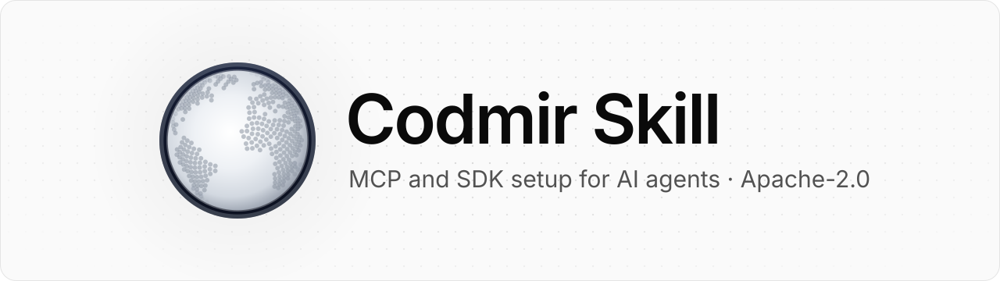
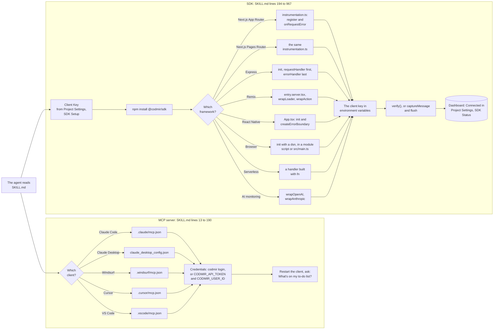

<p align="center">
  <picture>
    <source media="(prefers-color-scheme: dark)" srcset="docs/assets/hero-dark.svg">
    <source media="(prefers-color-scheme: light)" srcset="docs/assets/hero-light.svg">
    
  </picture>
</p>

<p align="center">
  <a href="LICENSE"></a>
  <a href="#the-sdk-framework-by-framework"></a>
</p>

<p align="center">
  <a href="#claude-code"></a>
  <a href="#claude-desktop"></a>
  <a href="#cursor"></a>
  <a href="#windsurf"></a>
  <a href="#github-copilot"></a>
  <a href="#vs-code"></a>
</p>

<p align="center">
  <a href="#what-is-in-this-repository"><b>What is here</b></a> ·
  <a href="#use-it-with-your-agent"><b>Use it with your agent</b></a> ·
  <a href="#what-it-sets-up"><b>What it sets up</b></a> ·
  <a href="#use-it-from-code"><b>Use it from code</b></a> ·
  <a href="#check-before-you-run-it"><b>Check before you run it</b></a> ·
  <a href="#faq"><b>FAQ</b></a> ·
  <a href="https://codmir.com"><b>codmir.com</b></a>
</p>

[Codmir](https://codmir.com) setup instructions written for AI agents. Point a coding agent at [`SKILL.md`](SKILL.md)
and it can connect its client to the Codmir MCP server, add [`@codmir/sdk`](https://github.com/codmir-labs/sdk) error
tracking to your project for the framework it uses, or both. `@codmir/skill`, the TypeScript library in [`src/`](src),
returns SDK setup instructions as strings, one set per framework, from an earlier version of that part of the file
([see the note](#the-sdk-framework-by-framework)).

> [!NOTE]
> Checked on 2026-11-23 against this repository at commit [`cf73faa`](https://github.com/codmir-labs/skill/commit/cf73faa),
> `@codmir/sdk` 2.0.1 and `@codmir/mcp` 0.2.5 (the latest releases on npm that day, each read from its tarball), and
> each client's documentation, linked where it is used. The SDK steps of `SKILL.md` have since been rewritten for 2.0.1
> and checked against it again. Two things to know before you run it: some of the code it has an agent write still
> does not run on 2.0.1 ([Check before you run it](#check-before-you-run-it)), and `@codmir/skill` is not on npm
> ([Use it from code](#use-it-from-code)).

<details>
<summary><b>Contents</b></summary>

- [What is in this repository](#what-is-in-this-repository)
- [Use it with your agent](#use-it-with-your-agent): [one command for every client](#one-command-for-every-client), [Claude Code](#claude-code), [Claude Desktop](#claude-desktop), [Cursor](#cursor), [Windsurf](#windsurf), [GitHub Copilot](#github-copilot), [VS Code](#vs-code), [any agent](#any-agent-point-it-at-skillmd)
- [What it sets up](#what-it-sets-up): [the MCP server](#the-mcp-server), [the SDK, framework by framework](#the-sdk-framework-by-framework)
- [How it works](#how-it-works)
- [Use it from code](#use-it-from-code): [build it from source](#build-it-from-source), [API](#api)
- [Check before you run it](#check-before-you-run-it): [the SDK](#the-sdk-against-codmirsdk-201), [the MCP server](#the-mcp-server-against-codmirmcp-025), [MCP config files](#mcp-config-files-against-each-clients-documentation)
- [FAQ](#faq)
- [Repository layout](#repository-layout)
- [Contributing](#contributing)
- [License](#license)

</details>

## What is in this repository

<table>
<tr>
<td width="33%" valign="top">
<br>
<b><a href="SKILL.md"><code>SKILL.md</code></a>, for agents</b><br>
967 lines in two parts: the Codmir MCP server for five clients (<a href="SKILL.md?plain=1#L13-L190">lines 13 to 190</a>), then <code>@codmir/sdk</code> for eight setups, with an API reference, verification and common issues (<a href="SKILL.md?plain=1#L194-L967">lines 194 to 967</a>).
</td>
<td width="33%" valign="top">
<br>
<b><code>@codmir/skill</code>, for code</b><br>
A TypeScript library whose functions return the instructions in <a href="src/instructions.ts"><code>src/instructions.ts</code></a> as strings. Version 0.1.0, and not on npm: <a href="#build-it-from-source">build it from source</a>.
</td>
<td width="33%" valign="top">
<br>
<b>Skill folders, one per task</b><br>
<a href="https://github.com/codmir-labs/skills">codmir-labs/skills</a> holds skills in the folder layout agents load, starting with <code>overseer</code>, which adds <code>@codmir/sdk</code> error tracking to an app.
</td>
</tr>
</table>

## Use it with your agent

`SKILL.md` is one skill file. Five of the six clients it names load a skill from a folder that holds a `SKILL.md`, and
Claude Desktop takes the same folder as a ZIP file. They differ in where the folder goes and in what its frontmatter
must say.

> [!NOTE]
> `SKILL.md` starts with frontmatter ([lines 1 to 4](SKILL.md?plain=1#L1-L4)): the `name` and `description` fields
> between two `---` lines, here `codmir` and a description of 174 characters. The
> [Agent Skills](https://agentskills.io/specification) standard requires both, and its reference validator,
> `skills-ref` 0.1.1, accepts the file in a folder named `codmir`: `Valid skill`.

What each client's documentation requires, and how `SKILL.md` meets it:

| Client | Its documentation | `SKILL.md` |
| --- | --- | --- |
| [Claude Code](#claude-code) | Every field is optional: `name` defaults to the folder name and `description` to the first non-empty line | Sets both; the description tells Claude when to use it |
| [Claude Desktop](#claude-desktop) | Anthropic's guide lists `name` and `description` as required, the description at most 200 characters | Has both; the description is 174 characters |
| [Cursor](#cursor) | `name` and `description` are required, and `name` must match the folder | Has both; `name` matches the `codmir/` folder |
| [Windsurf](#windsurf) | Frontmatter is optional: `name` defaults to the folder name, and `description` has no default | Sets both; the description is what the agent decides by |
| [GitHub Copilot](#github-copilot) | `name` and `description` are required | Has both |
| [VS Code](#vs-code) | Both are required, and a skill whose `name` does not match its folder is not loaded | Has both; `name` matches the `codmir/` folder |

### One command for every client

Where the folder goes:

| Client | In one project | For all your projects |
| --- | --- | --- |
| Claude Code | `.claude/skills/codmir/` | `~/.claude/skills/codmir/` |
| Cursor | `.cursor/skills/codmir/` | `~/.cursor/skills/codmir/` |
| Windsurf | `.devin/skills/codmir/` | `~/.config/devin/skills/codmir/` |
| GitHub Copilot | `.github/skills/codmir/` | `~/.copilot/skills/codmir/` |
| VS Code | `.github/skills/codmir/` | `~/.copilot/skills/codmir/` |
| Claude Desktop | A ZIP of a `codmir/` folder, uploaded to your account | The same upload |

From your project's root, on macOS, Linux, WSL or Git Bash, set `DEST` to your client's folder and run this. It makes
the folder and downloads `SKILL.md` into it:

<!-- snippet: install -->
```bash
DEST=.claude/skills/codmir   # your client's folder from the table above
mkdir -p "$DEST" &&
  curl -fsSL -o "$DEST/SKILL.md" https://raw.githubusercontent.com/codmir-labs/skill/main/SKILL.md
```

The file's `name`, `codmir`, matches the folder name, as Cursor and VS Code require and GitHub Copilot's documentation
says it typically does. The description is 174 characters, inside the 200 that Anthropic's guide allows for Claude
Desktop. Claude Code reads the frontmatter only when `---` is the first line of the file, as it is in `SKILL.md`. If
the server answers with an error, such as a 404, or cannot be reached, `curl` exits with an error and writes no
`SKILL.md`.

> [!WARNING]
> A skill is instructions your agent follows, and this one has it run `npm install`, edit your code and put keys in
> env files. GitHub's documentation warns that skills are not verified and may contain prompt injections, hidden
> instructions or malicious scripts, and says to inspect a skill before you install it. Read [`SKILL.md`](SKILL.md)
> and [Check before you run it](#check-before-you-run-it) first.

One copy can serve several clients: Cursor, GitHub Copilot and Windsurf all read `.agents/skills/`, and Cursor, GitHub
Copilot and VS Code's Claude harness also read `.claude/skills/`.

### Claude Code

Documentation: [Extend Claude with skills](https://code.claude.com/docs/en/skills).

- Put the folder in `.claude/skills/codmir/` and commit it to share it with everyone in the repository, or in
  `~/.claude/skills/codmir/` for all your projects.
- Claude Code watches these folders and picks up a change in the current session. If a new skill does not appear, run
  `/reload-skills`. To see what is loaded, ask `What skills are available?`.
- Run it with `/codmir`, or ask for the task and let Claude match your request to the description. Text you type
  after `/codmir` reaches Claude as `ARGUMENTS: <your input>` at the end of the skill, because `SKILL.md` has no
  `$ARGUMENTS` placeholder.
- `SKILL.md` is 967 lines. The documentation advises keeping a skill's `SKILL.md` under 500 lines and moving
  reference material into separate files.

### Claude Desktop

Documentation: [Use skills in Claude](https://support.claude.com/en/articles/12512180-use-skills-in-claude) and
[How to create custom skills](https://support.claude.com/en/articles/12512198-how-to-create-custom-skills). The guides
cover custom skills for Claude as a whole; they do not describe Claude Desktop separately.

- A custom skill is uploaded to your account as a ZIP file: open **Customize > Skills**, click **+**, then
  **+ Create skill**, then **Upload a skill**.
- Make the ZIP with the command above and `DEST=codmir`, then run `zip -r codmir.zip codmir`. The ZIP holds the
  `codmir/` folder at its root, as the guide requires, and the folder name matches `name`.
- Frontmatter is required here: `name`, at most 64 characters, and `description`, at most 200. In `SKILL.md` they
  are 6 and 174 characters.
- Skills need code execution. On Free, Pro, Max and Ultra plans, turn on **Code execution and file creation** (called
  **Create and edit files** in the updated layout) in **Settings > Capabilities**. On Team and Enterprise plans, code
  execution and Skills are both turned on in **Organization settings > Plugins & skills**, on the **Policy** tab; Team
  plans have skills on by default.

### Cursor

Documentation: [Agent Skills](https://cursor.com/docs/skills).

- Put the folder in `.cursor/skills/codmir/` for one project, or `~/.cursor/skills/codmir/` for all of them. Cursor
  also loads `.agents/skills/` and, for compatibility, `.claude/skills/`.
- `name` must match the folder name, and `description` is what the agent uses to decide when the skill is relevant.
- Type `/` in Agent chat and choose `codmir` to run it; a skill run this way attaches to one message. Open
  **Customize** in the sidebar and go to **Skills** to see what Cursor found.

### Windsurf

Windsurf is now Devin Desktop: its documentation announces the rename for 2 June 2026, and lives at docs.devin.ai. Its
local agent runs the same architecture as Devin CLI, so its skills use the CLI's format. See
[Devin Local customizations](https://docs.devin.ai/desktop/devin-local/customizations),
[Creating skills](https://docs.devin.ai/cli/extensibility/skills/creating-skills) and the
[Devin Desktop FAQ](https://docs.devin.ai/desktop/devin-desktop-faq).

- Put the folder in `.devin/skills/codmir/` for one workspace (`.agents/skills/` and the legacy `.windsurf/skills/` are
  also read), or `~/.config/devin/skills/codmir/` for all of them (`~/.agents/skills/` is also read).
- Frontmatter is optional: `name` defaults to the directory name, and `description` has no default. The description is
  what the agent is shown to decide whether to run the skill.
- Run it with `/codmir`, or let the agent run it when your request matches the description. The **Customize** page in
  the Agents window lists the skills that are loaded.

### GitHub Copilot

Documentation: [Adding agent skills for GitHub Copilot](https://docs.github.com/en/copilot/how-tos/copilot-on-github/customize-copilot/customize-cloud-agent/add-skills)
and [Agent skills](https://docs.github.com/en/copilot/concepts/customizations/agent-skills).

- Put the folder in `.github/skills/codmir/` for one repository (`.claude/skills/` and `.agents/skills/` work too), or
  `~/.copilot/skills/codmir/` for all of them (`~/.agents/skills/` works too).
- `name` and `description` are required, `name` lowercase with hyphens, and the file must be called `SKILL.md`.
- Copilot decides when to use a skill from your prompt and the skill's description.
- Skills work in the GitHub Copilot app, the Copilot CLI, Copilot cloud agent and code review on GitHub.com, and agent
  mode in Visual Studio Code, Visual Studio and JetBrains IDEs; the documentation says IDE support depends on your
  version.

### VS Code

Documentation: [Use Agent Skills in VS Code](https://code.visualstudio.com/docs/agent-customization/agent-skills).

- For Copilot, put the folder in `.github/skills/codmir/` in the workspace or `~/.copilot/skills/codmir/` for yourself.
  The Anthropic Claude harness in VS Code reads `.claude/skills/` and `~/.claude/skills/`.
- `name` is required, at most 64 characters of lowercase letters, numbers and hyphens, and must match the folder:
  otherwise the skill is not loaded. `description` is required too, at most 1,024 characters.
- Type `/` in chat to run it, or let Copilot load it when your request matches the description.

### Any agent: point it at SKILL.md

This repository's earlier README told you to point your AI tool at `SKILL.md`. That still works and installs nothing.
Paste this into the agent:

```text
Read https://raw.githubusercontent.com/codmir-labs/skill/main/SKILL.md and follow it to set up Codmir in this project.
```

It relies on three things:

- the agent can open that URL, through a web tool or a shell with network access;
- it follows whatever `main` holds when it reads the file;
- nothing stays behind, so the next session has to be pointed at the file again.

[Check before you run it](#check-before-you-run-it) applies to this route as much as to an installed skill.

## What it sets up

<table>
<tr>
<td width="50%" valign="top">
<br>
<b><a href="#the-mcp-server">The MCP server</a></b><br>
An MCP config entry that runs <code>npx @codmir/mcp</code> in Claude Code, Claude Desktop, Windsurf, Cursor or VS Code, its credentials, and a first question to check it (<a href="SKILL.md?plain=1#L13-L190">lines 13 to 190</a>).
</td>
<td width="50%" valign="top">
<br>
<b><a href="#the-sdk-framework-by-framework">The SDK</a></b><br>
<code>npm install @codmir/sdk</code>, the init and error-handling code for one of eight setups, the client key in an env file, and a test event (<a href="SKILL.md?plain=1#L194-L967">lines 194 to 967</a>).
</td>
</tr>
</table>

### The MCP server

For each of five clients, `SKILL.md` has the agent add a server named `codmir` that runs
`"command": "npx", "args": ["@codmir/mcp"]`, under `mcpServers`, to this file:

| Client | The file `SKILL.md` writes | Lines |
| --- | --- | --- |
| Claude Code | `.claude/mcp.json` in the project root, or `~/.claude/mcp.json` for every project | [19 to 38](SKILL.md?plain=1#L19-L38) |
| Claude Desktop | `claude_desktop_config.json`, in `~/Library/Application Support/Claude/` on macOS, `%APPDATA%\Claude\` on Windows or `~/.config/Claude/` on Linux | [40 to 61](SKILL.md?plain=1#L40-L61) |
| Windsurf | `.windsurf/mcp.json` | [63 to 76](SKILL.md?plain=1#L63-L76) |
| Cursor | `.cursor/mcp.json` | [78 to 91](SKILL.md?plain=1#L78-L91) |
| VS Code | `.vscode/mcp.json` | [93 to 106](SKILL.md?plain=1#L93-L106) |

The Claude Code and Claude Desktop entries also set `CODMIR_API_TOKEN` and `CODMIR_USER_ID`. `SKILL.md` says the
server reads those after `~/.codmir/credentials.json`, the file it says `codmir login` writes
([lines 108 to 121](SKILL.md?plain=1#L108-L121)). `SKILL.md` then lists 33 tools in five groups
([lines 123 to 180](SKILL.md?plain=1#L123-L180)) and ends with a check: restart the client and ask "What's on my
to-do list?" ([lines 182 to 190](SKILL.md?plain=1#L182-L190)). Which of these files each client reads is in
[MCP config files](#mcp-config-files-against-each-clients-documentation).

### The SDK, framework by framework

The library's nine framework ids, named in `FRAMEWORK_NAMES` ([`src/instructions.ts` lines 790 to 800](src/instructions.ts#L790-L800)),
what each set of instructions has the agent write and where, and the matching section of `SKILL.md`. In every set the
first step is `npm install @codmir/sdk`.

| Framework | Id and import | What the instructions write, and where | `src/instructions.ts` | `SKILL.md` |
| --- | --- | --- | --- | --- |
| Next.js | `nextjs`, `@codmir/sdk/nextjs` | Both Next.js sets below, after a rule for choosing: an `app/` directory means the App Router, `pages/` the Pages Router, and both the App Router | [208 to 226](src/instructions.ts#L208-L226) | [235 to 310](SKILL.md?plain=1#L235-L310) |
| Next.js (App Router) | `nextjs-app-router`, `@codmir/sdk/nextjs` | `instrumentation.ts` next to `next.config.js`, calling `Codmir.init` in `register()` and exporting `onRequestError`; `app/global-error.tsx` and `app/error.tsx` calling `Codmir.captureException`; `experimental.instrumentationHook` in `next.config.js`; the DSN in `.env.local` | [15 to 134](src/instructions.ts#L15-L134) | [235 to 290](SKILL.md?plain=1#L235-L290) |
| Next.js (Pages Router) | `nextjs-pages-router`, `@codmir/sdk/nextjs` | `Codmir.init` in `pages/_app.tsx`; `pages/_error.tsx` capturing the error and calling `Codmir.flush(2000)`; the DSN in `.env.local` | [136 to 205](src/instructions.ts#L136-L205) | [294 to 310](SKILL.md?plain=1#L294-L310) |
| Express.js | `express`, `@codmir/sdk/express` | In `src/app.ts`: `Codmir.init` before the app is created, `requestHandler()` as the first middleware, `tracingHandler()`, and `errorHandler()` after the routes | [232 to 307](src/instructions.ts#L232-L307) | [314 to 375](SKILL.md?plain=1#L314-L375) |
| Remix | `remix`, `@codmir/sdk/remix` | `Codmir.init` and `export const handleError` in `app/entry.server.tsx`; `wrapLoader` and `wrapAction` in route files; an `ErrorBoundary` in `app/root.tsx` | [313 to 406](src/instructions.ts#L313-L406) | [379 to 438](SKILL.md?plain=1#L379-L438) |
| React Native | `react-native`, `@codmir/sdk/react-native` | `Codmir.init` in `App.tsx`, the app wrapped in `Codmir.ErrorBoundary`; a navigation breadcrumb in `onStateChange`; `captureException` in async code | [412 to 499](src/instructions.ts#L412-L499) | [442 to 521](SKILL.md?plain=1#L442-L521) |
| Browser (Vanilla JS) | `browser`, `@codmir/sdk/browser` | `Codmir.init` in `src/main.ts` for a bundled app, or in an inline module script, with the DSN in a Vite, Create React App or Webpack variable | [505 to 572](src/instructions.ts#L505-L572) | [525 to 581](SKILL.md?plain=1#L525-L581) |
| Serverless (Lambda / Workers) | `serverless`, `@codmir/sdk/serverless` | An AWS Lambda handler and a Cloudflare Workers `fetch` handler built with `createApp` and `createFunction`, and a decorator-style alternative that makes the app with the `App` method of a `codmir` export and wraps the handler with `fn` | [578 to 666](src/instructions.ts#L578-L666) | [585 to 664](SKILL.md?plain=1#L585-L664) |
| AI Monitoring (OpenAI / Anthropic) | `ai-monitor`, `@codmir/sdk/ai` | In `src/ai-client.ts`: `CodmirAI.init`, `wrapOpenAI` and `wrapAnthropic` around the clients, `trackAICall` for other providers, and `getAIUsageSummary` | [672 to 770](src/instructions.ts#L672-L770) | [668 to 761](SKILL.md?plain=1#L668-L761) |

> [!NOTE]
> The library and `SKILL.md` set the SDK up two different ways. `src/instructions.ts` came with the repository's first
> commit, [`b2e7f0f`](https://github.com/codmir-labs/skill/commit/b2e7f0f), and has not changed since. Where it calls
> `init`, it passes a `dsn`: a variable such as `CODMIR_DSN` or `NEXT_PUBLIC_CODMIR_DSN`, or, in the React Native and
> some browser snippets, the URL itself. Its serverless set calls no `init`. `SKILL.md` moved to a `clientKey` and a
> `secretKey` in
> [`0fc0ce5`](https://github.com/codmir-labs/skill/commit/0fc0ce5), which changed no file in `src/`, and now passes
> only the `clientKey`, with a `dsn` as well in its browser and React Native snippets. Unlike the library's sets, it
> also keeps the SDK out of the code that Next.js and Remix bundle for the browser (see
> [The SDK against @codmir/sdk 2.0.1](#the-sdk-against-codmirsdk-201)). `init` in
> `@codmir/sdk` 2.0.1 accepts either a `dsn` or a `clientKey`.

## How it works

The flowchart uses only the steps `SKILL.md` gives. The two parts are independent: an agent can do either one alone.



## Use it from code

> [!NOTE]
> `@codmir/skill` 0.1.0 is not on npm: on 2026-11-23 the registry answered 404 for it. Build it from this repository
> as below; an `import` from `@codmir/skill` works once you have.

### Build it from source

<!-- snippet: build -->
```bash
git clone https://github.com/codmir-labs/skill.git
cd skill
npm install
npm run build
npm pack
```

`npm run build` runs tsup on `src/index.ts` and `src/instructions.ts` ([`package.json` line 14](package.json#L14)) and
writes ES modules (`dist/*.js`), CommonJS (`dist/*.cjs`) and type declarations (`dist/*.d.ts` and `dist/*.d.cts`).
The repository has no lockfile, so `npm install` takes the newest tsup and TypeScript that `^8.3.0` and `^5.4.5`
allow: tsup 8.5.1 and TypeScript 5.9.3 on 2026-11-23. `npm pack` writes `codmir-skill-0.1.0.tgz`; install that file in
your project:

```bash
npm install /path/to/skill/codmir-skill-0.1.0.tgz
```

> [!WARNING]
> `npm install github:codmir-labs/skill` installs the package without `dist/`. The repository does not commit `dist/`
> ([`.gitignore` line 2](.gitignore#L2)) and has no `prepare` script to build it, so an `import` of `@codmir/skill`
> then fails with `ERR_MODULE_NOT_FOUND`.

Then, in an ES module:

<!-- snippet: library -->
```js
import { getSupportedFrameworks, getImportPath, getInstallInstructions } from "@codmir/skill";

console.log(getSupportedFrameworks().join(" "));
// nextjs nextjs-app-router nextjs-pages-router express remix react-native browser serverless ai-monitor
console.log(getImportPath("express"));
// @codmir/sdk/express
console.log(getInstallInstructions("express").split("\n")[0]);
// # Codmir SDK -- Express.js Integration
```

`require("@codmir/skill")` gives the same exports from CommonJS, and `@codmir/skill/instructions` has the constants on
their own.

### API

Every export of [`src/index.ts`](src/index.ts). The constants come from `@codmir/skill` and also from
`@codmir/skill/instructions`. Each example ran against a build of `cf73faa`, and the last column is the value it
returned, as JSON.

<!-- api:start -->
| Export | Signature | Example | Returns |
| --- | --- | --- | --- |
| [`getInstallInstructions`](src/index.ts#L136-L148) | `(framework: string): string` | `getInstallInstructions(" Express ").split("\n")[0]` | `"# Codmir SDK -- Express.js Integration"` |
| [`getSupportedFrameworks`](src/index.ts#L162-L164) | `(): FrameworkId[]` | `getSupportedFrameworks().length` | `9` |
| [`getFrameworkList`](src/index.ts#L177-L183) | `(): FrameworkInfo[]` | `getFrameworkList()[3]` | `{"id":"express","name":"Express.js","importPath":"@codmir/sdk/express"}` |
| [`getFullSkill`](src/index.ts#L200-L202) | `(): string` | `getFullSkill().split("\n")[0]` | `"# Codmir SDK Installation Skill"` |
| [`getVerificationCode`](src/index.ts#L223-L235) | `(framework: string): string` | `getVerificationCode("express").split("\n")[1]` | `"Codmir.init({ dsn: process.env.CODMIR_DSN });"` |
| [`getImportPath`](src/index.ts#L250-L262) | `(framework: string): string` | `getImportPath("ai-monitor")` | `"@codmir/sdk/ai"` |
| [`NEXTJS_INSTRUCTIONS`](src/instructions.ts#L208-L226) | `string` | `NEXTJS_INSTRUCTIONS.split("\n")[0]` | `"# Codmir SDK -- Next.js Integration"` |
| [`NEXTJS_APP_ROUTER_INSTRUCTIONS`](src/instructions.ts#L15-L134) | `string` | `NEXTJS_APP_ROUTER_INSTRUCTIONS.split("\n")[0]` | `"## Next.js App Router Setup"` |
| [`NEXTJS_PAGES_ROUTER_INSTRUCTIONS`](src/instructions.ts#L136-L205) | `string` | `NEXTJS_PAGES_ROUTER_INSTRUCTIONS.split("\n")[0]` | `"## Next.js Pages Router Setup"` |
| [`EXPRESS_INSTRUCTIONS`](src/instructions.ts#L232-L307) | `string` | `EXPRESS_INSTRUCTIONS.split("\n")[0]` | `"# Codmir SDK -- Express.js Integration"` |
| [`REMIX_INSTRUCTIONS`](src/instructions.ts#L313-L406) | `string` | `REMIX_INSTRUCTIONS.split("\n")[0]` | `"# Codmir SDK -- Remix Integration"` |
| [`REACT_NATIVE_INSTRUCTIONS`](src/instructions.ts#L412-L499) | `string` | `REACT_NATIVE_INSTRUCTIONS.split("\n")[0]` | `"# Codmir SDK -- React Native Integration"` |
| [`BROWSER_INSTRUCTIONS`](src/instructions.ts#L505-L572) | `string` | `BROWSER_INSTRUCTIONS.split("\n")[0]` | `"# Codmir SDK -- Browser Integration"` |
| [`SERVERLESS_INSTRUCTIONS`](src/instructions.ts#L578-L666) | `string` | `SERVERLESS_INSTRUCTIONS.split("\n")[0]` | `"# Codmir SDK -- Serverless Integration"` |
| [`AI_MONITOR_INSTRUCTIONS`](src/instructions.ts#L672-L770) | `string` | `AI_MONITOR_INSTRUCTIONS.split("\n")[0]` | `"# Codmir SDK -- AI Monitoring Integration"` |
| [`FRAMEWORK_INSTRUCTIONS`](src/instructions.ts#L777-L787) | `Record<string, string>` | `FRAMEWORK_INSTRUCTIONS.remix === REMIX_INSTRUCTIONS` | `true` |
| [`FRAMEWORK_NAMES`](src/instructions.ts#L790-L800) | `Record<string, string>` | `FRAMEWORK_NAMES["ai-monitor"]` | `"AI Monitoring (OpenAI / Anthropic)"` |
| [`FRAMEWORK_IMPORTS`](src/instructions.ts#L803-L813) | `Record<string, string>` | `FRAMEWORK_IMPORTS.browser` | `"@codmir/sdk/browser"` |
| [`FRAMEWORK_VERIFICATION`](src/instructions.ts#L816-L855) | `Record<string, string>` | `FRAMEWORK_VERIFICATION.serverless.split("\n")[0]` | `"import { createApp } from '@codmir/sdk/serverless';"` |
<!-- api:end -->

And two types, for TypeScript ([lines 94 to 115](src/index.ts#L94-L115)):

<!-- snippet: types -->
```ts
import { getFrameworkList, type FrameworkId, type FrameworkInfo } from "@codmir/skill";

const id: FrameworkId = "remix"; // one of the nine ids above
const info: FrameworkInfo = getFrameworkList()[4]; // { id, name, importPath }
```

`getInstallInstructions`, `getVerificationCode` and `getImportPath` trim the id and lower-case it, and throw an `Error`
for one they do not know. `getImportPath("vue")` throws `Unsupported framework: "vue". Supported frameworks:`, then
the nine ids, separated by commas.

> [!WARNING]
> `getFullSkill()` does not return `SKILL.md`. It returns `SKILL_MD_CONTENT` ([`src/index.ts` lines 36 to 84](src/index.ts#L36-L84)),
> a 48-line summary titled `# Codmir SDK Installation Skill`, which uses a DSN and has no MCP part. A comment above it
> says it is embedded at build time; it is a string written into the source, and the build reads no Markdown file.
> The instruction sets the library returns use a DSN too, except the serverless one, which sets neither a DSN nor a
> key; the [note above](#the-sdk-framework-by-framework) explains.

## Check before you run it

On 2026-11-23 the latest releases on npm were `@codmir/sdk` 2.0.1 and `@codmir/mcp` 0.2.5, and `npx @codmir/mcp` ran
0.2.5. Rows marked "run" were run against the installed package, with requests caught before they left the process; the
others were read from it. Line numbers in the third column are in the package's files.

### The SDK against @codmir/sdk 2.0.1

| `SKILL.md` or `src/instructions.ts` tells the agent to | `@codmir/sdk` 2.0.1 | Source |
| --- | --- | --- |
| Wrap the app in `<Codmir.ErrorBoundary>` from `@codmir/sdk/react-native` (`src/instructions.ts` [439](src/instructions.ts#L439)) | The entry has no `ErrorBoundary` export, so `Codmir.ErrorBoundary` is `undefined`. It has `createErrorBoundary(React)`, which returns an error-boundary class that takes a `fallback` prop | `dist/react-native/index.js:82-109`, run |
| `import { codmir, fn } from '@codmir/sdk/serverless'`, then make the app with its `App` method (`src/instructions.ts` [643](src/instructions.ts#L643), [645](src/instructions.ts#L645)) | There is no `codmir` export, and Node stops at the import: `The requested module '@codmir/sdk/serverless' does not provide an export named 'codmir'`. The entry has `app(config)` and `fn(app, config)` instead, and a function built with `fn(app, options)(handler)` ran | `dist/serverless/index.js:996-1001`, run |
| `createFunction(app, options)(handler)` (`src/instructions.ts` [598](src/instructions.ts#L598), [624](src/instructions.ts#L624)) | `createFunction(app, config, handler)` takes the handler as a third argument and returns the function object, so the call throws `TypeError: createFunction(...) is not a function` | `dist/serverless/index.js:464-466`, run |
| `export const handler = processEvent.local` (`src/instructions.ts` [611](src/instructions.ts#L611), [614](src/instructions.ts#L614)) | `local` and `remote` are methods that use `this`. Called on its own, `local` throws `TypeError: Cannot read properties of undefined (reading 'executionCount')`; `processEvent.local(event)` works | `dist/serverless/index.js:301-303`, run |
| Import the SDK in a file that Next.js or Remix also builds for the browser: `app/global-error.tsx`, `app/error.tsx`, `pages/_app.tsx`, `pages/_error.tsx` or `app/root.tsx` (`src/instructions.ts` [49](src/instructions.ts#L49), [79](src/instructions.ts#L79), [149](src/instructions.ts#L149), [164](src/instructions.ts#L164), [373](src/instructions.ts#L373)), or at the top of `instrumentation.ts` ([29](src/instructions.ts#L29)), which Next.js also builds for the Edge runtime when the app has middleware | Every error-tracking entry imports Node's `events`, `crypto`, `fs`, `os` and `path`, through a chunk it shares with the package's agent code. `next build` (Next.js 15.5.29) failed on each of the four Next.js files with `Module not found: Can't resolve 'fs'`, and on the top-level import, next to a middleware file, with `Can't resolve 'crypto'`; `remix vite:build` (Remix 2.17.5) failed on `app/root.tsx` with `"EventEmitter" is not exported by "__vite-browser-external"`. `SKILL.md` keeps the SDK out of these files ([264 to 266](SKILL.md?plain=1#L264-L266), [302 to 304](SKILL.md?plain=1#L302-L304), [430 to 432](SKILL.md?plain=1#L430-L432)) and imports it in `instrumentation.ts` only when `NEXT_RUNTIME` is `nodejs` ([242 to 261](SKILL.md?plain=1#L242-L261)): with Next.js 15.5.29 and a middleware file, that built, and the server sent the error of a page that threw | `dist/chunk-6CRI34ER.js:267-268`, `dist/chunk-DYRMB7WS.js:2-3`, `:1559-1561`, run |
| Bundle `@codmir/sdk/browser` into a page (`SKILL.md` [534 to 550](SKILL.md?plain=1#L534-L550) and [556 to 566](SKILL.md?plain=1#L556-L566), which [529](SKILL.md?plain=1#L529) warns do not build on 2.0.1; `src/instructions.ts` [523](src/instructions.ts#L523), [540](src/instructions.ts#L540)) | The same imports. esbuild with `--platform=browser` failed with `Could not resolve "events"` while the same bundle for Node built, and `vite build` (Vite 6.4.1) failed with `"EventEmitter" is not exported by "__vite-browser-external"` | `dist/chunk-6CRI34ER.js:267-268`, `dist/chunk-DYRMB7WS.js:1559-1561`, run |
| Call `init` in a React Native app (`SKILL.md` [463 to 467](SKILL.md?plain=1#L463-L467), which [446](SKILL.md?plain=1#L446) warns throws on 2.0.1; `src/instructions.ts` [429](src/instructions.ts#L429)) | `init` reads `window.location.origin` for its default endpoint before it looks at the `dsn`. React Native makes `window` the global object and defines no `location`, so with React Native's globals `init` threw `TypeError: Cannot read properties of undefined (reading 'origin')`, with a `dsn` and without one | `dist/chunk-6CRI34ER.js:1146`, `Libraries/Core/setUpGlobals.js` in React Native 0.72.17 and 0.88.1, run |
| Leave the secret key out of `init` ([207](SKILL.md?plain=1#L207), [799](SKILL.md?plain=1#L799)) | `init` stores a `secretKey` and nothing reads it: the request that sends an event does not contain it | `dist/chunk-6CRI34ER.js:1150`, run |
| Pass a `dsn` to the browser `init` ([527](SKILL.md?plain=1#L527), [539](SKILL.md?plain=1#L539), [560](SKILL.md?plain=1#L560)) | Given a key and no `dsn`, `init` picks the endpoint: `https://codmir.com/api/overseer` in Node, but `/api/overseer` on the page's own origin in a browser, so these events go to `/api/overseer/ingest` on your own site. With the `dsn` line, both snippets, run in a stub page, sent their events to `https://codmir.com/api/overseer/ingest` | `dist/chunk-6CRI34ER.js:1145-1148`, `:1338`, run |
| Set `tracesSampleRate`, `replaysSessionSampleRate` and `replaysOnErrorSampleRate` (`src/instructions.ts` [35 to 37](src/instructions.ts#L35-L37), [336](src/instructions.ts#L336)) | `init` stores the three numbers and no other line of the package reads them | `dist/chunk-6CRI34ER.js:1157-1159` |
| Set `captureNativeCrashes`, `trackScreenViews` and `trackAppState` (`src/instructions.ts` [432 to 434](src/instructions.ts#L432-L434)) | `init` takes the three options and no other line reads them. The global error handler that `init` installs after the core client starts does not depend on them; in React Native the core client does not start on 2.0.1 (the `init` row above) | `dist/react-native/index.js:21-23`, `:27-40` |
| Confirm the setup with `verify()` or `quickVerify()`, then find the test event in the dashboard ([809](SKILL.md?plain=1#L809), [822](SKILL.md?plain=1#L822)) | Both report success whatever the server says. `quickVerify` returned `true` when the server answered 401, and `verify()` returned `success: true` when the request failed: the request's status is never read, a failed flush is reported as a success, and the last step always reports `Connection verified`. `quickVerify` also treats its argument as a key only when it starts with `osk_` or `csk_`, and as a DSN otherwise | `dist/verify/index.js:63-91`, `:93-95`, `dist/chunk-6CRI34ER.js:1285-1296`, `:1346-1350`, run |
| Read `totalTokens`, `callCount` and `errorCount` from `getAIUsageSummary()` (`src/instructions.ts` [752](src/instructions.ts#L752)) | It returns `totalCalls`, `totalInputTokens`, `totalOutputTokens`, `totalCost`, `avgLatencyMs`, `byProvider` and `byModel` | `dist/ai/index.js:326-335`, run |
| Call `close()` to stop the flush timer and send queued events ([779](SKILL.md?plain=1#L779)) | `close()` stops the timer and flushes, and leaves the SDK on: `captureException` after it still returned an event id | `dist/chunk-6CRI34ER.js:1297-1302`, run |
| Write each snippet as TypeScript (`.ts`, `.tsx`), with the declaration file `SKILL.md` adds ([222 to 227](SKILL.md?plain=1#L222-L227)) | The package ships no `.d.ts` file although `types` names `./dist/index.d.ts`, so with `strict` on, `tsc` fails at the import with `TS7016: Could not find a declaration file for module '@codmir/sdk/nextjs'`. With `declare module '@codmir/sdk/*';` in a file that `tsconfig.json` includes, the same imports type-check | `package.json:8`, tsc 5.9.3, run |

What matches 2.0.1, under the names `SKILL.md` uses: `npm install @codmir/sdk`; the Next.js functions (`init` and
`captureRouterError`, imported in `instrumentation.ts` only on Node.js, and `captureMessage` and `flush` in its test
snippet); the Express middleware (`requestHandler`, `tracingHandler`, `errorHandler`) and its `extractUser` option; the
Remix helpers (`handleError`, `wrapLoader`, `wrapAction`); `createErrorBoundary` and `addBreadcrumb` in React Native;
the browser options (`captureGlobalErrors`, `captureUnhandledRejections`, `captureConsoleErrors`, `trackClicks`);
`app` and `fn` from `@codmir/sdk/serverless`, with `local()` called on the function; the AI functions (`wrapOpenAI`,
`wrapAnthropic`, `trackAICall`, `getAIUsageSummary`); `isOverseerInitialized` in the framework entries; and `verify`,
`quickVerify` and `printVerifyResult`, with the caveat above. Every snippet that runs in Node ran, with its requests
caught before they left the process. For the others, every name a snippet uses was checked against its entry's
exports, the Next.js and Remix steps were built with `next build` (Next.js 15.5.29 and 14.2.35) and `remix vite:build`
(Remix 2.17.5), and the built Next.js apps were served with their requests caught.

### The MCP server against @codmir/mcp 0.2.5

| `SKILL.md` says | `@codmir/mcp` 0.2.5 and the hosted connector | Source |
| --- | --- | --- |
| Run the server with `"command": "npx", "args": ["@codmir/mcp"]` ([27 to 28](SKILL.md?plain=1#L27-L28), [52 to 53](SKILL.md?plain=1#L52-L53), [71 to 72](SKILL.md?plain=1#L71-L72), [86 to 87](SKILL.md?plain=1#L86-L87), [101 to 102](SKILL.md?plain=1#L101-L102)) | This starts 0.2.5. The package has one command, `codmir-mcp`, and [`npm exec`](https://docs.npmjs.com/cli/v9/commands/npm-exec) runs a package's only command. Started both ways, `npx @codmir/mcp` and `npx -y -p @codmir/mcp codmir-mcp` answered `initialize` and listed 33 tools. The second form, which the [codmir-labs/mcp](https://github.com/codmir-labs/mcp) README uses, names the command, so it does not depend on the package having only one | `package.json:32-34`, run |
| `codmir login` writes `~/.codmir/credentials.json`, and "Not authenticated" means run it ([38](SKILL.md?plain=1#L38), [112](SKILL.md?plain=1#L112), [117 to 121](SKILL.md?plain=1#L117-L121), [190](SKILL.md?plain=1#L190)) | 0.2.5 has no `codmir` command, and its own messages say `Run "overseer login"`. It reads `~/.codmir/credentials.json` first, then `CODMIR_API_TOKEN` and `CODMIR_USER_ID`, with `CODMIR_API_URL` defaulting to `https://codmir.com`: the order `SKILL.md` gives ([110 to 113](SKILL.md?plain=1#L110-L113)) | `dist/server.js:35-93`, `:872` |
| 33 tools in five groups ([123 to 180](SKILL.md?plain=1#L123-L180)) | The same 33 names that 0.2.5 returns from `tools/list` | run |
| Desktop control needs the Codmir desktop app ([164](SKILL.md?plain=1#L164)) | 0.2.5 finds the app through `~/.codmir/agent-port`, and answers `Codmir desktop agent not found. Is the app running?` without it | `dist/server.js:100`, `:127` |
| `com.codmir/mcp` in the MCP Registry ([17](SKILL.md?plain=1#L17)) | Listed, at version 0.2.3, while npm has 0.2.5 | [the registry's API](https://registry.modelcontextprotocol.io/v0/servers?search=com.codmir/mcp) |
| Only a local server, signed in with a token ([13 to 190](SKILL.md?plain=1#L13-L190)) | Codmir also runs a hosted connector at `https://mcp.codmir.com/`. You sign in with OAuth in the browser, so there is no token to paste and nothing runs on your machine. The steps for Claude are below | `curl`: 401 until you sign in |

To use the hosted connector from Claude:

| Client | How | Anthropic's guide |
| --- | --- | --- |
| Claude.ai | **Customize > Connectors**, click **+ Add**, then **Add custom connector**, with the URL `https://mcp.codmir.com/` | [Custom connectors using remote MCP](https://support.claude.com/en/articles/11175166-get-started-with-custom-connectors-using-remote-mcp) |
| Claude Desktop | The same steps: remote connectors are configured through your Claude account, even in Claude Desktop | [Custom connectors using remote MCP](https://support.claude.com/en/articles/11175166-get-started-with-custom-connectors-using-remote-mcp) |
| Claude Code | `claude mcp add --transport http codmir https://mcp.codmir.com/`, then `/mcp` in a session to sign in | [Connect Claude Code to tools via MCP](https://code.claude.com/docs/en/mcp) |

### MCP config files against each client's documentation

| Client | `SKILL.md` writes | The client's documentation says |
| --- | --- | --- |
| Claude Code | `.claude/mcp.json`, or `~/.claude/mcp.json` ([21](SKILL.md?plain=1#L21)) | A project's servers go in `.mcp.json` at the project root, and local and user servers in `~/.claude.json`; `claude mcp add` writes them. `.claude/mcp.json` is not one of the places it lists. [Claude Code MCP](https://code.claude.com/docs/en/mcp) |
| Claude Desktop | `claude_desktop_config.json` at three paths ([44 to 46](SKILL.md?plain=1#L44-L46)) | The same three paths, for macOS, Windows and Linux. [Connect to local MCP servers](https://modelcontextprotocol.io/docs/develop/connect-local-servers) |
| Windsurf | `.windsurf/mcp.json` ([65](SKILL.md?plain=1#L65)) | Devin Local reads `.devin/mcp_config.json` in the project and `~/.config/devin/mcp_config.json` for the user, and Cascade reads `~/.config/devin/mcp_config.json` (`%AppData%/devin/mcp_config.json` on Windows). `.windsurf/mcp.json` is not among them. [Devin Local customizations](https://docs.devin.ai/desktop/devin-local/customizations), [Cascade MCP](https://docs.devin.ai/windsurf/plugins/cascade/mcp) |
| Cursor | `.cursor/mcp.json` ([80](SKILL.md?plain=1#L80)) | The same file for one project, and `~/.cursor/mcp.json` for every project. [Cursor MCP](https://cursor.com/docs/mcp) |
| VS Code | `.vscode/mcp.json`, under `mcpServers` ([95 to 104](SKILL.md?plain=1#L95-L104)) | `.vscode/mcp.json` belongs to the deprecated editor-managed format, whose top-level key is `servers`, not `mcpServers`. For Copilot, put the `mcpServers` block in `.mcp.json` at the workspace root or in `~/.copilot/mcp-config.json`. [VS Code MCP configuration](https://code.visualstudio.com/docs/agents/reference/mcp-configuration) |
| GitHub Copilot | Nothing: it is named on [line 8](SKILL.md?plain=1#L8) and has no MCP section | |

## FAQ

<details>
<summary><b>Is @codmir/skill on npm?</b></summary>

No. On 2026-11-23 `https://registry.npmjs.org/@codmir%2fskill` answered 404. [Build it from source](#build-it-from-source)
and install the `.tgz` that `npm pack` writes. Check again with `npm view @codmir/skill version`.

</details>

<details>
<summary><b>Do I need both the MCP server and the SDK?</b></summary>

No. They are separate parts of `SKILL.md`. The MCP server gives your AI client Codmir's tools, such as tickets and
errors; the SDK sends your app's errors to Codmir. Ask the agent for the one you want.

</details>

<details>
<summary><b>Which version of the SDK do the instructions target?</b></summary>

`@codmir/sdk` 2.0.1, which `SKILL.md`'s version table names ([line 967](SKILL.md?plain=1#L967)) and which was the
latest release on 2026-11-23: `npm install @codmir/sdk` installs the latest. Check yours with
`npm view @codmir/sdk version`, and see [Check before you run it](#the-sdk-against-codmirsdk-201) for what does not work
on 2.0.1.

</details>

<details>
<summary><b>Which address is the hosted MCP connector?</b></summary>

`https://mcp.codmir.com/`, signed in with OAuth. `https://codmir.com/mcp` is not an MCP endpoint: it redirects to the
Codmir sign-in page.

</details>

<details>
<summary><b>Why does getFullSkill() not return SKILL.md?</b></summary>

It returns a summary written into `src/index.ts` in the repository's first commit, before `SKILL.md` moved to client
keys and gained its MCP part. See the warning under [API](#api).

</details>

<details>
<summary><b>How is this repository different from codmir-labs/skills?</b></summary>

This repository is one large skill file plus a library. [codmir-labs/skills](https://github.com/codmir-labs/skills)
keeps one folder per skill, in the layout the clients above load.

</details>

<details>
<summary><b>Where do I report a problem?</b></summary>

In [GitHub Issues](https://github.com/codmir-labs/skill/issues).

</details>

## Repository layout

| Path | What it holds |
| --- | --- |
| [`SKILL.md`](SKILL.md) | The skill: 967 lines, starting with its frontmatter |
| [`src/index.ts`](src/index.ts) | The library's functions and types, and the summary `getFullSkill()` returns |
| [`src/instructions.ts`](src/instructions.ts) | The nine sets of framework instructions, and the maps from id to instructions, name, import path and test snippet |
| [`package.json`](package.json) | `@codmir/skill` 0.1.0: the tsup build, and the exports `.` and `./instructions` |
| [`tsconfig.json`](tsconfig.json) | TypeScript settings: strict, ES2022, declarations on |
| [`.gitignore`](.gitignore) | Ignores `node_modules/`, `dist/`, `*.tgz` and `.DS_Store` |
| [`docs/assets/`](docs/assets) | This page's hero and icons |
| [`LICENSE`](LICENSE) | Apache License 2.0, Copyright 2024-2026 Codmir Labs |
| [`README.md`](README.md) | This page |

## Contributing

- `SKILL.md` and `src/instructions.ts` describe the same SDK setups, so a change to one framework belongs in both. Today
  they differ, as the [note above](#the-sdk-framework-by-framework) explains.
- Build with `npm install` and `npm run build`, then try the result with a script like the one under
  [Build it from source](#build-it-from-source).
- The frontmatter stays on the first lines of `SKILL.md`: `name`, 1 to 64 lowercase letters, numbers and hyphens,
  equal to the folder name, and `description`, saying what the skill does and when to use it. Validate a skill folder
  with `skills-ref`, the reference library the [specification](https://agentskills.io/specification) points to;
  version 0.1.1 installs its command as `agentskills`. It checks that `name` matches the folder, so validate a copy in
  a folder named `codmir`:

  ```bash
  pip install skills-ref
  mkdir -p codmir && cp SKILL.md codmir/
  agentskills validate codmir
  ```

- Open issues and pull requests in [codmir-labs/skill](https://github.com/codmir-labs/skill).

## License

[Apache-2.0](LICENSE)
